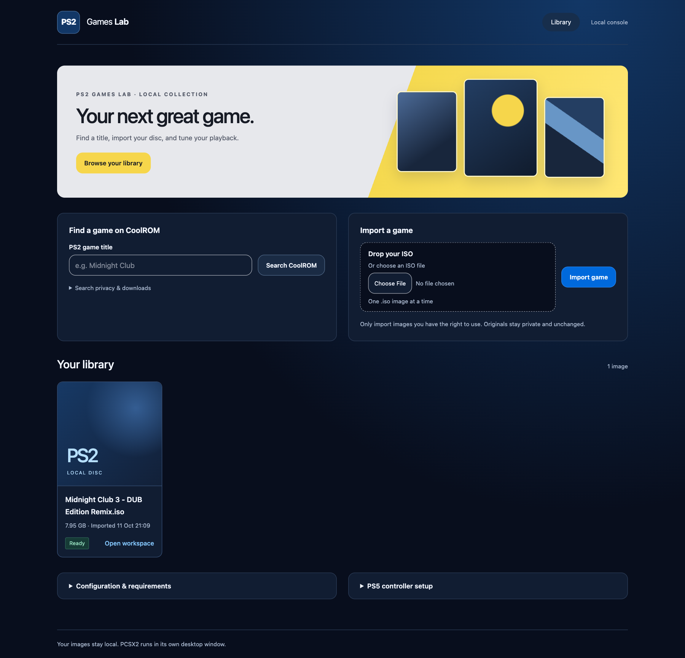
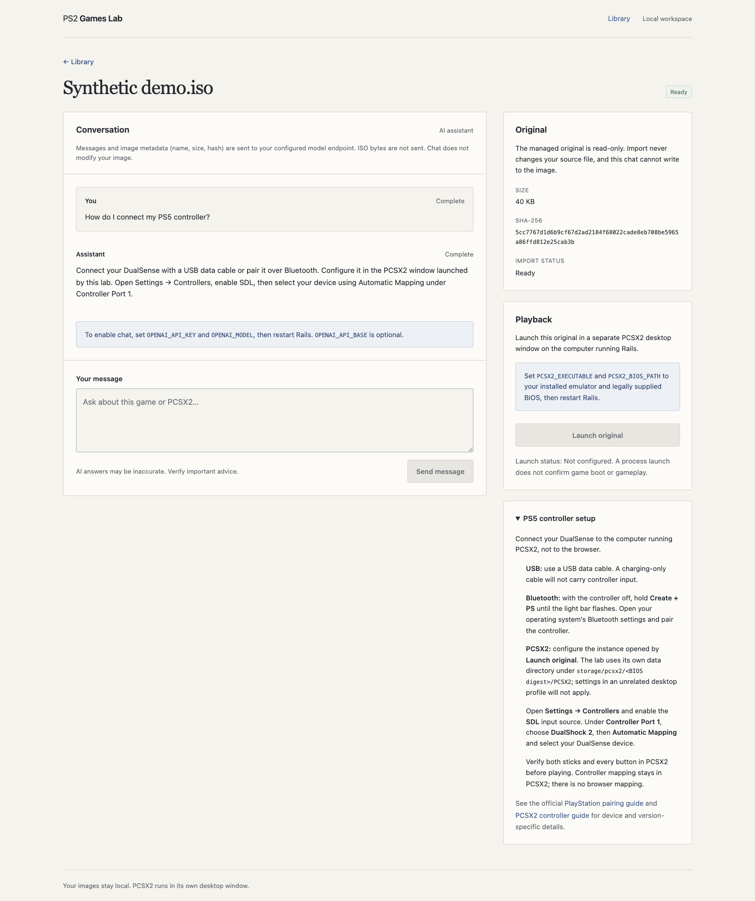

# PS2 Games Lab

A local Rails workspace for importing PS2 disc images, tuning per-game PCSX2 playback without changing ISO bytes, and optionally discussing games through Google Gemini or an OpenAI-compatible endpoint.

**Working today:** PS2 title search on CoolROM with external game-page links, ISO drag-and-drop import, private read-only originals with SHA-256 verification, per-game PCSX2 tuning, persistent optional conversations, incremental replies over Server-Sent Events (SSE), and a configured desktop launcher.

**Not implemented:** binary inspection tools for the model, patch proposals/approval, modified-image builds, game-specific asset editors, or online multiplayer. Chat cannot modify or inspect the ISO. This application is a lab, not a universal natural-language game editor.

## Interface

The library and game workspace occupy the full content width, without a permanent setup sidebar. Import uses a compact horizontal panel below the library. Game settings are the primary workspace controls beneath playback; the optional AI assistant opens in a collapsible conversation panel. Configuration requirements, original-image metadata, and the PS5 controller guide expand only when needed.

The design uses a warm off-white canvas, ink text, a muted blue accent, thin borders, and compact navigation instead of gradients, decorative tiles, or numbered onboarding panels. Controls stack on narrow screens. Pages use normal document scrolling, not nested scroll panes. Streamed message updates preserve composer drafts, provider/model selection, the assistant's expanded state, and unsaved tuning choices. Saving or resetting tuning also preserves the composer. Controller mapping stays in PCSX2.

## Screenshots

The library capture shows a recorded local game and live CoolROM search results. The chat capture shows that game’s conversation, provider/model controls, and a live Gemini reply following an earlier OpenAI provider rejection. These are running-application captures, not proof of game boot, controller input, or PCSX2 gameplay. The model receives conversation text and image metadata, not ISO bytes. No game or BIOS files are in this repository.

### Import and library

### Game workspace and chat

## Run locally

Requirements: Ruby **3.4.2** (see .ruby-version), Bundler, and enough free disk space for multi-gigabyte images. SQLite is used through Active Record; no Redis or PostgreSQL is needed. Import works without a model or emulator configured.

~~~sh
git clone git@github.com:luisgsilva950/ps2-games-lab.git
cd ps2-games-lab
bin/setup --skip-server
cp .env.example .env
bin/dev
~~~

Open **http://127.0.0.1:3000**. The development process starts Rails, the Tailwind watcher, and the Solid Queue worker. Keep all three running; importing and model replies depend on the worker. Set PORT before bin/dev to change the HTTP port.

Only run this application locally. There is no user authentication or hardened public-upload deployment. Do not bind it to the public internet.

## Configure chat

Copy .env.example to .env and edit the local file before starting bin/dev. For **Google Gemini** with your existing Gemini API key:

~~~dotenv
CHAT_PROVIDER=gemini
GEMINI_API_KEY=your-private-gemini-api-key
GEMINI_MODEL=gemini-2.5-flash
~~~

Gemini uses RubyLLM’s native Google transport, not an OpenAI compatibility URL. If `GEMINI_MODEL` is unset, it defaults to `gemini-2.5-flash`. Use an exact model ID available to your key and account; an API key’s presence alone does not prove model access, quota, or billing availability.

For **OpenAI or an OpenAI-compatible server**:

~~~dotenv
CHAT_PROVIDER=openai
OPENAI_API_BASE=https://api.openai.com/v1
OPENAI_MODEL=your-provider-model-id
OPENAI_API_KEY=your-private-api-key
~~~

`CHAT_PROVIDER` accepts `openai` (the default when unset) or `gemini`. Both sets of credentials may coexist. The workspace has an **AI provider** selector and an editable **Model ID**. Changing vendors fills that vendor’s configured default model; you can override the model before sending. A missing credential shows setup guidance without locking the selector, model field, or draft. Sending requires a ready image and no pending reply; the server checks the selected vendor’s configuration before queueing work. Credentials never enter the browser.

Each assistant reply records the selected provider and model when queued. Changing the next reply’s selection while a reply streams does not reroute the pending request. Reloading uses the latest assistant provider/model snapshot, or the environment defaults when no snapshot exists; legacy replies without provider/model metadata do not override those defaults.

Use your provider’s exact model ID. For another OpenAI-compatible server, change `OPENAI_API_BASE` to its API base URL, typically ending in `/v1`. It must support streaming Chat Completions. Local servers may use a nonempty placeholder key if they do not require authentication. API base URLs remain server-side environment configuration, not browser or model-controlled input.

dotenv-rails automatically loads .env in development and test; existing shell environment variables take precedence when starting Rails directly. Foreman also reads .env by default. For shell overrides with bin/dev, use `bin/dev --env /dev/null`; Rails still loads unset values from .env. The file is ignored by Git. Restart both Rails and the worker after changes. Do not commit credentials or paste them into chat. Production configuration uses the process environment.

The selected vendor receives your new message, prior completed conversation history, and image metadata: name, size, SHA-256, and import status. **Switching vendors sends that completed history to the newly selected vendor on the next request. ISO contents are not transmitted.** Chat cannot inspect or modify the image. Provider requests can incur charges.

One reply may be pending per image. Prompts are limited to 4,000 characters, replies to 8,000, and existing conversation plus a new prompt to 24,000. The full model prompt has a 32,000-character limit. Errors are recorded without displaying raw provider error bodies or credentials.

### SSE, not Action Cable

RubyLLM requests a streamed provider response. The job persists partial content at a bounded rate; the browser's EventSource receives escaped message snapshots from GET /game_images/:id/events. This also updates import progress. Connections close after completion or rotate after 25 seconds; automatic reconnect receives current persisted state rather than replaying duplicated tokens.

The composer is not replaced during partial updates. Sending a message retains the current scroll position and returns focus to the composer without a success-confirmation banner. A final workspace refresh preserves an unsent draft, the selected provider and editable model (including changes made during an in-flight reply), focus, and scroll. Navigating away closes the browser stream without cancelling the durable job. There is no WebSocket chat, Action Cable engine, or Solid Cable dependency. The server samples persisted state; the browser does not periodically poll page requests.

## Find a game online

1. In the library, enter a PS2 title in **Find a game on CoolROM**, then select **Search CoolROM**.
2. Choose a result to open its CoolROM game page in a separate browser tab. The library and any selected ISO remain in place.
3. Only download images you are authorized to obtain. Handle downloads and archive extraction yourself; never run executable downloaders or bundled installers.
4. Return to the library and import the extracted `.iso`. Searching or opening a result does not download, import, or launch a game.

The Rails backend sends the search title to `https://coolrom.com/search` with the PS2 filter. It reads at most 1 MiB of HTML, with an eight-second request deadline, and shows up to 25 PS2 links. It does not follow redirects, render third-party HTML/scripts, fetch game files, or contact model endpoints for search. Titles and links are treated as untrusted data. CoolROM is an external website, not a supported API; outages or changed pages produce an explicit unavailable state without affecting local import. No API key is needed.

## Import an image

1. Extract your disc image before importing: **.iso only**. ZIP, 7z, CHD, and installers are not accepted.
2. Drop one ISO into the box to start automatically, or use the file picker and Import game button.
3. Watch upload progress. A background job checks the ISO9660 primary volume descriptor, copies the image into private managed storage, verifies its hash, and makes the original read-only.
4. The game workspace opens with per-game settings. AI is optional: expand the assistant and choose a provider/model if you want to chat.
5. PCSX2 launches automatically after import when configured. Missing setup does not prevent import or chat.

The ISO signature check identifies the supported disc format; it does not prove PS2 compatibility, authenticity, malware safety, or bootability. Keep your own backups. The application does not change the selected source file.

Allow up to **three times the image size in additional temporary space during upload/import**, plus your external source copy. Completed imports retain one managed copy. Hashing/copying large images takes time, but does not load the whole image into Ruby memory.

## Configure PCSX2 on macOS

Install PCSX2 from [its official download page](https://pcsx2.net/downloads/) and supply a BIOS you have the right to use. Nothing proprietary is bundled or downloaded automatically.

Add these settings to your ignored `.env`, then restart `bin/dev`:

~~~dotenv
PCSX2_EXECUTABLE="/Applications/PCSX2.app/Contents/MacOS/PCSX2"
PCSX2_BIOS_PATH="/absolute/path/to/your/ps2-bios.bin"
~~~

The executable name/location above is illustrative: use the actual executable inside your installed .app, **not the .app directory**. PCSX2_BIOS_PATH can be a readable BIOS file or a directory; directory mode picks the first sorted readable .bin/.rom file. Prefer an explicit main BIOS file so auxiliary ROM files are not selected by mistake. PCSX2 is responsible for validating the firmware.

The launcher uses the [documented PCSX2 Qt CLI](https://pcsx2.net/docs/advanced/cli) with a fixed argument array: -datapath, -batch, optionally -unlimited, --, and the managed ISO. It never constructs a shell command from a prompt or filename. It verifies image size/hash and refuses symlink/hardlink originals before launching. If PCSX2 is already running, close it normally first; the lab refuses to launch over an active session and never kills it.

Settings and saves are isolated under storage/pcsx2/<digest-of-resolved-BIOS-path>/PCSX2/, separate from your normal PCSX2 profile. PCSX2 2.8.2 appends `PCSX2` to the supplied `-datapath`; the launcher creates `PCSX2/inis/PCSX2.ini` there to select the supplied BIOS. Existing settings are preserved. Configure your DualSense/controller within this lab-specific emulator profile. Existing emulator sessions are not killed automatically.

**Launched means a process was started—not that a window rendered, the BIOS loaded, or the game booted.** An emulator that exits after startup may still have this status. Verify actual playback in the desktop window. A browser cannot embed or directly launch PCSX2; the local Rails backend starts it on the same machine.

## Tune a game without changing its ISO

Run `bin/rails db:migrate` after upgrading. Each imported game stores its own validated tuning choices in Active Record; the default empty settings object inherits PCSX2 configuration. No model credentials are required.

| Setting | Available overrides |
| --- | --- |
| Internal resolution | Native, 2×, 3×, 4×, 6× |
| Renderer | Automatic, Metal, Vulkan, OpenGL, Software |
| Texture filtering | PS2 automatic, nearest, forced bilinear |
| Audio synchronization | Time stretch, disabled |
| Frame limiter | Enabled (normal speed), disabled (unlimited) |

Every field also offers **Inherit PCSX2 settings**. **Save settings** persists choices without starting the emulator. **Save and launch** saves first, then invokes the same original-image launcher; a setup or launch failure leaves the saved choices intact and reports playback failure separately. **Launch original** uses the last saved choices, not unsaved form edits.

The launcher applies graphics/audio overrides to the identified disc's native `PCSX2/gamesettings/<serial>_<CRC>.ini` inside the existing BIOS-specific lab profile. It preserves unrelated keys, controller overrides, and saves, and remembers prior native tuning values in a small lab-owned sidecar. **Reset to inherit** clears only the database choices; on the next launch, lab overrides are removed and preexisting native values restored. Nothing changes in a running session. Disc identification or safe configuration failures are explicit, not silently ignored.

These are PCSX2 2.8.2 settings, not game patches. Higher resolution costs GPU resources; renderers depend on platform support, and software rendering may ignore hardware scaling/filtering. Unlimited speed and disabled audio synchronization can affect timing; they do not unlock a game's native frame rate. Async audio is not offered because PCSX2 2.8.2 removed it. Actual boot, visuals, audio, and gameplay require checking the separate PCSX2 window.

Local verification with PCSX2 2.8.2 observed Midnight Club 3's intro running with Metal at 1024×896 (2×), the selected time-stretch audio backend, and the preserved controller profile. Reset followed by another launch restored Automatic (Metal) at 512×448 (1×). A second launch while PCSX2 was running was refused without closing that session. These checks prove configuration consumption and boot, not improved sound, higher gameplay FPS, or gameplay compatibility.

## Set up a PS5 DualSense controller

Controller mapping is configured directly in PCSX2, not in this Rails app. Use the **PCSX2 window launched by the lab**: its settings live in the isolated data directory above, so configuring a separately opened PCSX2 with its default profile will not configure lab playback.

1. **USB:** connect the DualSense to the Mac with a USB-C **data-capable cable** (a charge-only cable will not expose the controller).
2. **Bluetooth:** disconnect USB and turn the controller off. Hold **Create + PS** until the light bar flashes, then open **macOS System Settings → Bluetooth** and connect **Wireless Controller** (the displayed name can vary). See [Sony’s official Bluetooth pairing guide](https://www.playstation.com/en-gb/support/hardware/pair-dualsense-controller-bluetooth/).
3. In the lab-launched PCSX2 window, open **Settings → Controllers** and enable the **SDL** input source. In **Controller Port 1**, set the controller type to **DualShock 2**, select **Automatic Mapping**, and choose the detected DualSense/Wireless Controller device. Selecting a device is required; enabling SDL alone does not map the port. See [PCSX2’s controller configuration guide](https://pcsx2.net/docs/configuration/controllers).
4. Check the bindings and test the D-pad, face buttons, shoulder buttons/triggers, both sticks, and stick clicks in PCSX2; then confirm menu navigation and controls in the game. If Automatic Mapping does not work, check that SDL detects the device and disable SDL Raw Input. DualShock 4 / DualSense Enhanced Mode is optional. Hardware input and gameplay still need a hands-on check.
5. If a particular game behaves differently, inspect its **Properties → Controllers** / per-game controller settings in PCSX2. A per-game override or selected input profile can take precedence over global settings; adjust or clear that override in PCSX2, then save and restart the game when required. Do not discard an unsaved emulator session.

**Existing exports remain user-controlled.** The app no longer creates, imports, assigns, updates, or clears controller profiles. Upgrading with `bin/rails db:migrate` removes only the old lab database profiles and mapping columns; it does not delete or rewrite existing PCSX2 input profiles, per-game configuration, settings, or saves. Old exported profiles and their per-game selections may therefore remain active until you change them yourself in PCSX2.

## Architecture and safety

| Component | Responsibility |
| --- | --- |
| Rails 8.1.4 / Ruby 3.4 | Local monolith, HTTP, domain behavior |
| Active Record / SQLite | Image metadata, messages, and durable job state |
| ERB / Turbo / Stimulus / Tailwind | Library, upload progress, chat, responsive UI |
| Solid Queue | Background import and provider jobs |
| RubyLLM | Native Gemini and OpenAI-compatible streaming transports |
| ActionController::Live / EventSource | SSE delivery; no Action Cable |
| Private filesystem storage | Large images and isolated PCSX2 settings |
| Minitest integration tests | HTTP, real persistence, artifacts, failures, and SSE |

All DB access uses Active Record. Game images are files, not database blobs. Files are addressed by generated validated storage identities, not model-selected paths. The model has no shell, binary-read tools, or write access. Originals are exclusively created, hash-verified, and read-only. Duplicate import jobs do not overwrite originals. Failed imports never expose partial images as ready.

A future modification workflow must create a unique separate output from a recorded immutable base, require validated length-preserving patches and explicit approval, and distinguish patch validity from emulator/gameplay verification. That workflow is not available in this release.

## Tests and verification

~~~sh
bin/rails test
bin/rails zeitwerk:check
bin/rubocop
bin/brakeman --quiet --no-pager
bin/bundler-audit check --update
bin/importmap audit
~~~

The integration suite uses deterministic synthetic images, real SQLite/Active Record, and a local HTTP streaming fixture at the provider boundary. It covers source preservation, read-only exact copies, duplicate jobs, rejected archives/invalid images, existing-output collisions, chat context ordering, pending-request exclusion, provider failures/secret redaction, unsafe or mutated launch inputs, SSE reconnect snapshots, HTML escaping, and missing-image errors. Per-game settings coverage includes every allowed choice, inheritance, malformed/unsupported values, cross-game isolation, save-before-launch orchestration, failed-launch persistence, reset, and unchanged original bytes/permissions.

Observed verification for this release:

- Per-game settings integration checks: 11 tests, 103 assertions passed; development migration applied. Browser interaction confirmed the optional assistant controls and preserved an unsent composer draft, provider/model selection, expanded state, and unsaved 3× resolution through the workspace refresh path; the 390px viewport had no horizontal overflow.

- 14 integration tests, 90 assertions passed, including storage-parent and reply-lock symlink regressions that failed against the previous implementation.
- Browser file-picker upload and automatic drop import completed through the real Solid Queue worker.
- Browser observed partial SSE content before completion; an unsent draft survived completion.
- Desktop and 390px-wide UI checked; no horizontal overflow at 390px.
- Zeitwerk loading and Ruby style checks passed.
- Local macOS smoke imported an 8,539,963,392-byte Midnight Club 3: DUB Edition Remix ISO through the browser and Solid Queue. Source and read-only managed copy retained matching SHA-256 hashes.
- Official PCSX2 2.8.2 archive matched its published SHA-256. The actual launcher loaded the supplied BIOS, identified disc serial `SLUS-21355` / CRC `60A42FF5`, initialized Metal, and logged the game ELF executing.
- Visual gameplay and DualSense input remain unverified: this automation process lacked macOS Screen Recording and Accessibility permissions, and hardware discovery found no matching connected PlayStation controller. No permission bypass was attempted. BIOS/game files, emulator settings, and local `.env` stay Git-ignored.
- Rails loaded emulator/BIOS settings from the ignored `.env` without shell exports.

For the remaining hands-on check, follow the DualSense setup guide above in the lab-launched PCSX2 window, then confirm menus, steering, and acceleration in a race. Desktop automation requires macOS permissions granted by the user; those permissions are not required to play manually.

Brakeman runs with all default checks and warning failures enabled: the corrected storage boundary produces zero warnings and zero scanner errors. Image staging/import IO belongs to GameImage, behind strict UUID, fixed-filename, and symlink checks; the controller and job only orchestrate it. Reply locks use validated integer job identities and refuse symlinks/hardlinks. Bundler Audit with freshly updated advisory data and Importmap Audit passed locally. Both GitHub CI and bin/ci refresh the gem advisory database before scanning. No scanner checks were disabled; the vulnerability ignore list is empty.

RubyLLM 2.1 is installed; it retains the fix for CVE-2026-67987 affecting the previously installed 1.16 release. Chats explicitly select the Chat Completions protocol because RubyLLM 2.x otherwise defaults OpenAI requests to the Responses API. The existing OpenAI-compatible endpoint contract, SSE delivery, and application-owned Active Record messages are preserved. Version 2.1 was verified with the integration suite and a real ChatReplyJob receiving a streamed response from a local HTTP model fixture. The browser partial/completed SSE workflow was previously verified on 2.0; neither check is a live OpenAI account verification.

## Troubleshooting

- **Import stays pending:** ensure bin/dev's jobs process is running. Check log/development.log and the worker output.
- **Import fails:** use an extracted ISO9660 image and check free disk space. Retry as a new import; existing originals are never overwritten.
- **Chat is disabled:** set OPENAI_API_KEY and OPENAI_MODEL; restart the app and worker. Configuration presence alone does not prove provider access.
- **Response fails:** check streaming chat support, API base, model ID, credentials, and provider billing/network status. No fake fallback response is generated.
- **SSE buffers behind a proxy:** disable proxy response buffering/compression for text/event-stream. The app sets X-Accel-Buffering: no; direct localhost is the supported setup.
- **Playback is disabled:** configure both emulator and BIOS paths and restart. Inspect the PCSX2 window for startup/firmware errors.
- **Mac blocks the emulator:** follow the official PCSX2 installation guidance; the lab does not disable Gatekeeper.

## AI engineering harness

Read AGENTS.md, then .agents/AGENTS.md. Principles are inspired by DHH's Rails conventions and Akita on Rails' focus on fundamentals and measured costs—not quotations or endorsement. Prefer cohesive Active Record models, simple Ruby, integration tests, and explicit security boundaries.

Reusable task prompts:

- Read .agents/skills/rails-plan/SKILL.md and plan a feature.
- Read .agents/skills/rails-build/SKILL.md and implement a complete Rails feature.
- Read .agents/skills/rails-review/SKILL.md and review a change.
- Read .agents/skills/ps2-investigate/SKILL.md and investigate a specific game modification read-only.

The Rails specialist is .agents/agents/rails-specialist.md. Discovery/slash-command support depends on your AI client. These are developer-assistant instructions, not runtime model permissions.

## Rights and repository hygiene

Only import images and BIOS files you have the right to use. This project is not affiliated with Sony, Rockstar, or PCSX2. Publishing modified games/assets requires the necessary rights; private experimentation does not grant redistribution rights.

Git excludes storage/, tmp/, logs, .env secrets, config/master.key, and disc/archive files. Screenshots show library metadata, external search results, and conversation text; no game or firmware bytes are included. Keep games, firmware, saves, databases, and API keys out of commits.
